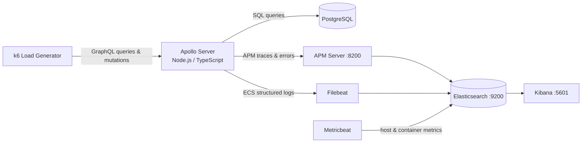

---
## 🚀 About Me

I'm a junior DevOps engineer with some expertise in BackEnd development using Java and Node.js; scripting skills with Python, Bash and JavaScript; besides CI/CD and cloud knowledge of AWS and Azure DevOps tools ...

<p align="center">

</p>


## 🔗 Portfolio

[](https://github.com/RecursiveDeveloper)
[](https://www.linkedin.com/in/jhoan-jesus-ortiz-sandoval-a66152198/)

# ELK Stack Lab

A local observability lab built around an Apollo GraphQL server instrumented with Elastic APM. The stack collects application traces, structured logs, and host metrics through the full ELK pipeline — Elasticsearch, Kibana, APM Server, Filebeat, and Metricbeat — all wired together with Docker Compose. A k6 load generator runs continuously to produce realistic traffic without manual queries.

## Project Architecture



The Apollo Server is the only application service. It resolves GraphQL queries against PostgreSQL, forwards APM trace data to the APM Server, and emits ECS-formatted JSON logs that Filebeat autodiscovers from the Docker container. Metricbeat collects system and container metrics independently. All data lands in Elasticsearch and is visualised in Kibana.

## Project Structure

```text
elk_stack-lab/
├── apollo-server/
│   ├── src/
│   │   ├── apm.ts           # Elastic APM agent initialisation (must load first)
│   │   ├── db.ts            # PostgreSQL pool, schema creation, and seed data
│   │   ├── logger.ts        # Winston logger with ECS formatter
│   │   └── index.ts         # GraphQL schema, resolvers, and server entry point
│   ├── package.json
│   └── tsconfig.json
├── elk-config/
│   ├── apm-server/
│   │   └── apm-server.yml   # APM Server configuration
│   ├── elasticsearch/
│   │   └── elasticsearch.yml
│   ├── filebeat/
│   │   └── filebeat.yml     # Autodiscover config targeting the apolloserver container
│   ├── kibana/
│   │   └── kibana.yml
│   └── metricbeat/
│       └── metricbeat.yml   # System, CPU, memory, network, filesystem, process metrics
├── load-generator/
│   └── script.js            # k6 load test: ramp, hold, ramp-down with mixed query/mutation traffic
├── docker-compose.yml
├── dockerfile               # Multi-stage build: Node.js 22 builder + slim runtime
├── .gitignore
└── README.md
```

## Features

- **GraphQL API:** Queries for books and authors, single-item lookups, and `addBook` / `addAuthor` mutations backed by PostgreSQL.
- **Elastic APM instrumentation:** Every resolver wraps its database call in a named APM span. Errors are captured with `apm.captureError()` and appear in the Kibana APM UI with full stack traces.
- **ECS structured logging:** Winston emits JSON in Elastic Common Schema format. Each log entry carries `trace.id` and `transaction.id`, so logs correlate directly with APM traces in Kibana.
- **Filebeat log collection:** Filebeat autodiscovers the `apolloserver` container and ships its stdout logs to Elasticsearch.
- **Metricbeat host metrics:** CPU, memory, network, filesystem, and process metrics collected every 10 seconds with pre-built Kibana dashboards.
- **Continuous load generation:** k6 ramps to 10 virtual users, holds for 2 minutes, then ramps down. Each VU fires a randomised mix of list queries, single-item lookups, and occasional mutations.
- **Deterministic startup order:** Compose health checks ensure Elasticsearch is healthy before Kibana, APM Server, and the beats start; PostgreSQL must be healthy before the Apollo Server starts.
- **Multi-stage Docker build:** A builder stage compiles TypeScript; the runtime stage installs only production dependencies, keeping the final image small.

## GraphQL Schema

### Queries

| Operation | Description |
|---|---|
| `books` | Returns all books with id and title. |
| `book(id: Int!)` | Returns a single book by id. |
| `authors` | Returns all authors with id and name. |
| `author(id: Int!)` | Returns a single author by id. |

### Mutations

| Operation | Description |
|---|---|
| `addBook(title: String!, authorId: Int!)` | Inserts a new book and returns it. |
| `addAuthor(name: String!)` | Inserts a new author and returns them. |

## Prerequisites

- [Docker Engine or Docker Desktop](https://docs.docker.com/get-docker/)
- Docker Compose v2, included with current Docker Desktop. Verify with:
  ```sh
  docker compose version
  ```
- Git to clone the repository.

Node.js is not required on the host; the application is built and run entirely inside Docker.

## Usage

### Start the stack

```sh
git clone https://github.com/RecursiveDeveloper/elk_stack-lab.git
cd elk_stack-lab
docker compose --progress auto up --build -d
```

The full stack takes 2–3 minutes to become healthy. Elasticsearch initialises first (~40 s), then Kibana and APM Server come up, and finally the application services and beats start.

### Check service status

```sh
docker compose ps
docker compose logs -f apolloserver
```

### Access the services

| Service | URL |
|---|---|
| Apollo Server (GraphQL) | http://localhost:3000 |
| Kibana | http://localhost:5601 |
| Elasticsearch | http://localhost:9200 |
| APM Server | http://localhost:8200 |

### Query the GraphQL API manually

```sh
curl -X POST http://localhost:3000 \
  -H "Content-Type: application/json" \
  -d '{"query": "{ books { id title author { name } } }"}'
```

### Verify data in Elasticsearch

```sh
# Check index health
curl http://localhost:9200/_cat/indices?v

# Check Filebeat collected Apollo Server logs
curl http://localhost:9200/filebeat-7.17.19-*/_search?pretty&size=1
```

### Stop the stack

Remove everything including volumes (resets all Elasticsearch data):
```sh
docker compose down --rmi all --remove-orphans -v
```

## Application Components

| Component | Responsibility |
|---|---|
| [`apollo-server/src/apm.ts`](apollo-server/src/apm.ts) | Starts the Elastic APM agent before any other module loads. Reads service name, server URL, and environment from env vars. |
| [`apollo-server/src/logger.ts`](apollo-server/src/logger.ts) | Creates a Winston logger with the ECS formatter. Log level controlled by `LOG_LEVEL` env var. |
| [`apollo-server/src/db.ts`](apollo-server/src/db.ts) | Opens a PostgreSQL connection pool and runs `initDb()` to create tables and insert seed data on first boot. |
| [`apollo-server/src/index.ts`](apollo-server/src/index.ts) | Defines the GraphQL schema and resolvers. Each resolver opens an APM span, queries PostgreSQL, and logs the result. |
| [`load-generator/script.js`](load-generator/script.js) | k6 test script. Stages: ramp to 10 VUs over 30 s, hold 2 min, ramp down 15 s. Thresholds: <5 % errors, p95 < 2 s. |
| [`elk-config/filebeat/filebeat.yml`](elk-config/filebeat/filebeat.yml) | Autodiscovers the `apolloserver` container by image name and ships its logs to Elasticsearch. |
| [`elk-config/metricbeat/metricbeat.yml`](elk-config/metricbeat/metricbeat.yml) | Collects system, CPU, memory, network, filesystem, and process metrics every 10 s. |
| [`elk-config/apm-server/apm-server.yml`](elk-config/apm-server/apm-server.yml) | Receives trace data on port 8200 and forwards it to Elasticsearch. |
| [`dockerfile`](dockerfile) | Multi-stage build. Builder stage compiles TypeScript with `tsc`; runtime stage runs `npm ci --omit=dev` for a lean final image. |
| [`docker-compose.yml`](docker-compose.yml) | Defines all nine services, health checks, startup dependencies, networks, and volumes. |

## Requirements

### Container images

| Service | Image |
|---|---|
| Apollo Server | `node:22-alpine` (built locally) |
| PostgreSQL | `postgres:17-alpine` |
| k6 | `grafana/k6:0.57.0` |
| Elasticsearch | `elasticsearch:7.17.19` |
| Kibana | `kibana:7.17.19` |
| APM Server | `elastic/apm-server:7.17.19` |
| Filebeat | `elastic/filebeat:7.17.19` |
| Metricbeat | `docker.elastic.co/beats/metricbeat:7.17.19` |

### Apollo Server dependencies

| Dependency | Version |
|---|---|
| `@apollo/server` | `^4.11.3` |
| `graphql` | `^16.10.0` |
| `elastic-apm-node` | `^4.9.0` |
| `winston` | `^3.17.0` |
| `@elastic/ecs-winston-format` | `^1.5.3` |
| `pg` | `^8.13.3` |
| `typescript` | `^5.7.3` |

## Authors

- [@RecursiveDeveloper](https://github.com/RecursiveDeveloper)

## License

[MIT](https://choosealicense.com/licenses/mit/)
